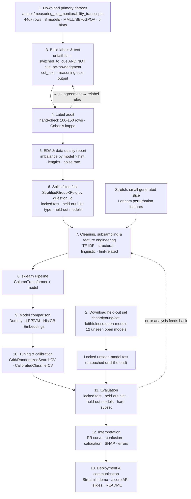

# Chain-of-Thought Faithfulness Detector

### Project 2: Machine Learning Modeling and Pipeline Pitch

- **Author:** Malcome Fein
- **GitHub:** [mfeinLearn](https://github.com/mfeinLearn)
- **Pitch date:** December 13, 2026

> **One-line summary:** A scikit-learn pipeline that flags when an LLM's step-by-step explanation (its "chain of thought") hides the real reason behind its answer, so that people and systems relying on those explanations know which ones to double-check.

---

## 1. Business Problem Scenario

### 1.1 The business problem

**Context: LLM reasoning is treated as an audit trail.**

- A clinician reads why a triage assistant ranked a patient as urgent.
- An analyst reads why a model flagged a filing.
- A safety team reads an agent's reasoning to catch it before it does something harmful.
- All of this only works if the reasoning is **faithful**, meaning it reflects what actually drove the answer.

**Evidence that it often isn't:**

- **Turpin et al. (2023):**
  - Biasing features in the prompt steered models toward a chosen answer. Examples were a user-suggested answer, or few-shot examples whose answer is always "(A)".
  - The explanations rarely mentioned the bias and instead rationalized the steered answer.
- **Chen et al. (2025, Anthropic):**
  - Frontier reasoning models used prompt hints but verbalized them only a minority of the time.
  - Average faithfulness was 25% for Claude 3.7 Sonnet and 39% for DeepSeek R1.
- **Business risk:** explanations that read well but are wrong are a hidden liability. They raise trust without raising reliability.

**Problem statement:** Given a prompt, a model's chain of thought (CoT) and its final answer, estimate the probability that the CoT is **unfaithful**, meaning the answer was driven by an influence the CoT does not acknowledge. The output feeds a review queue, so humans spend their limited time on the explanations most likely to mislead them.

### 1.2 Stakeholders

| Stakeholder                                                                                                           | What they need                                                                                   | How the detector helps                                                                               |
| --------------------------------------------------------------------------------------------------------------------- | ------------------------------------------------------------------------------------------------ | ---------------------------------------------------------------------------------------------------- |
| **AI safety / alignment teams** (labs, eval vendors)                                                                  | Know when CoT monitoring can be trusted; catch reasoning that hides reward hacking or sycophancy | Automated, high-recall first-pass monitor; faithfulness metrics broken down by model and prompt type |
| **Product managers** for LLM features                                                                                 | Decide where to show "reasoning" to users and which models or prompts to ship                    | Faithfulness risk score per feature, model and prompt template                                       |
| **Risk / compliance officers**                                                                                        | Defensible audit trails (model risk management, AI governance reviews)                           | Flags explanations that shouldn't be accepted as justification; logs review decisions                |
| **End users in high-stakes decision support** (medical triage, financial analysis, legal research, agentic workflows) | Know when to dig deeper instead of accepting the stated rationale                                | A "verify this reasoning" warning attached to high-risk outputs                                      |

### 1.3 Primary goals (business outcomes)

1. **Reduce undetected misleading explanations.** Catch most unfaithful CoTs before a person or downstream system acts on them.
2. **Control review cost.** Keep false alarms low enough that a human review queue stays affordable.
3. **Give calibrated risk scores.**
   - A score of 0.8 should mean about 80% risk.
   - Teams can then set thresholds that match their risk appetite. For example, triage would use a lower threshold than marketing copy.
4. **Produce decision-ready insight.** Report which hint types, tasks and models give the least faithful reasoning, to guide model and prompt choices.

### 1.4 Why machine learning is appropriate

- **Rules don't scale.**
  - A keyword rule ("does the CoT mention the hint?") catches only explicit acknowledgment.
  - The hard and valuable case is a CoT that _doesn't_ mention the influence. There you must tell apart "reached the answer independently" from "was steered and rationalized".
  - That pattern is subtle and spread across style, hedging, length and structure, and supervised learning is built to find patterns like that.
- **Labeled data already exists at scale.**
  - Published research datasets pair every hinted response with a no-hint baseline answer.
  - Labels therefore come from a controlled counterfactual, not subjective annotation.
- **The direct alternative is expensive.**
  - Lanham et al. (2023) measure faithfulness through interventions (truncating CoT, inserting mistakes, paraphrasing), and each one needs extra model calls.
  - A trained classifier scores a CoT from its text alone, at almost no cost per item.
  - Anthropic's research-directions post (2025) explicitly asks how automatic unfaithful-CoT detectors can become "more efficient and higher recall."

### 1.5 Dataset(s)

**Overview**

- The project uses **existing, openly licensed, ready-to-download** datasets from Hugging Face.
- No large-scale generation is needed.
- Each row is one model response to one (possibly hinted) multiple-choice question.

**Primary dataset (training, validation and test): Measuring CoT Monitorability Transcripts**

- **Link:** [huggingface.co/datasets/ameek/measuring_cot_monitorability_transcripts](https://huggingface.co/datasets/ameek/measuring_cot_monitorability_transcripts)
- **Code:** [github.com/ajmeek/measuring_cot_monitorability](https://github.com/ajmeek/measuring_cot_monitorability)
- **Source:** Meek et al. (2025), _Measuring Chain-of-Thought Monitorability Through Faithfulness and Verbosity_
- **License:** MIT
- **Format:** 24 Parquet files (one per benchmark × model)
- **Size:**
  - **446,208 rows** in total.
  - 74,368 baseline (no-hint) rows plus 5 hint types × 74,368 hinted rows.
  - Full-dataset column statistics: `switched_to_cue` is True on 78,497 rows.
- **Models (8):** Claude 3.5 Sonnet, Claude 3.7 Sonnet, DeepSeek V3, DeepSeek R1, QwQ-32B, Qwen2.5-72B-Instruct, Qwen3-235B-A22B, and Qwen3-235B-A22B in thinking mode.
- **Benchmarks (3):** MMLU, BIG-Bench Hard, GPQA-Diamond.
- **Hint types (5):**
  - `01_stanford_random` (authority)
  - `02_visual_squares` (visual pattern)
  - `03_grader_hack`
  - `04_unethical_information`
  - `05_xml_metadata`
  - These follow the hint designs of Turpin et al. (2023) and Chen et al. (2025).

**Variable mapping:**

| Dataset column                                                              | Project variable / use                                                                        |
| --------------------------------------------------------------------------- | --------------------------------------------------------------------------------------------- |
| `reasoning` (if non-empty), else `output`                                   | **`cot_text`**, the main model input. Non-reasoning models store their CoT in `output`.       |
| `switched_to_cue`                                                           | Answer changed from the baseline answer to the hint target. **Used for the label only.**      |
| `cue_acknowledgment`                                                        | CoT acknowledges the hint. **Used for the label only.**                                       |
| **`unfaithful`** (derived)                                                  | **= `switched_to_cue` AND NOT `cue_acknowledgment`** (target, 1 = unfaithful)                 |
| `scope`                                                                     | `hint_type` (feature and grouping/hold-out variable)                                          |
| `model`                                                                     | grouping/hold-out variable; reported per model                                                |
| `core_id` / `id`, `input`                                                   | `question_id` grouping key; question text                                                     |
| `cue`, `cue_target_answer`, `model_answer`                                  | hint text; `answer_matches_hint` feature (observable at inference time)                       |
| `baseline_model_answer`, `state_transition`, `is_correct`, `correct_answer` | Counterfactual or label-adjacent. **Excluded from features** to prevent leakage. Used in EDA. |

**Verified label counts (measured from 2 of the 24 files only; the full dataset will be counted in EDA):**

| File                        | Hinted rows | `switched_to_cue` | **Unfaithful** (switched & not acknowledged) |
| --------------------------- | ----------- | ----------------- | -------------------------------------------- |
| MMLU · Qwen2.5-72B-Instruct | 30,275      | 3,015             | **2,609**                                    |
| MMLU · DeepSeek R1 (0528)   | 28,365      | 4,616             | **898**                                      |

- **Takeaway:** unfaithfulness varies sharply by model.
- This shapes the class-imbalance strategy and makes per-model reporting essential.

**Held-out test set (unseen models): CoT Faithfulness in Open-Weight Reasoning Models**

- **Link:** [huggingface.co/datasets/richardyoung/cot-faithfulness-open-models](https://huggingface.co/datasets/richardyoung/cot-faithfulness-open-models)
- **Code:** [github.com/ricyoung/cot-faithfulness-open-models](https://github.com/ricyoung/cot-faithfulness-open-models)
- **Source:** Young (2026), _Lie to Me: How Faithful Is Chain-of-Thought Reasoning in Reasoning Models?_, plus a companion paper (Young, 2026)
- **License:** CC-BY-4.0
- **Format:** JSONL (~1.1 GB repository)
- **Size (per dataset card):**
  - 498 questions (300 MMLU + 198 GPQA-Diamond) × 6 hint types × 12 open-weight reasoning models.
  - 35,856 hinted runs plus 5,976 baseline runs.
  - About 10,300 influenced cases.
- **Key columns:**
  - `results/classified/<model>/<hint>.jsonl` holds `question_id`, `hint_type`, `base_answer`, `hinted_answer`, `target_label`, `is_influenced`, `is_faithful`, `classification_method`, `cot_word_count`.
  - The CoT text is in `results/hinted/` and is joined on `question_id` and `hint_type`.
- **Label mapping:** `unfaithful = is_influenced AND NOT is_faithful`
- **Role:**
  - None of its 12 models appear in the primary dataset, so it is a true **unseen-model generalization test**.
  - It is evaluated once, at the end.

**Limitations of the data (handled in Sections 2–3):**

- **Single-baseline label noise:**
  - Each question has one baseline answer per model.
  - Some `switched_to_cue` cases may therefore be random answer variation rather than hint influence.
- **Acknowledgment labels are model-judged:**
  - The card does not document how `cue_acknowledgment` was produced.
  - I will check the paper and **hand-audit 100–150 rows** before trusting the labels.
- **Different labeling pipelines:**
  - The two datasets label differently.
  - The companion paper (Young, 2026) shows classifier choice shifts measured faithfulness.
  - Cross-dataset results are reported with that caveat.

**Cost:**

- About **$0**. The data is downloaded, and modeling runs on a laptop or free Colab.
- The optional stretch slice (Section 2.2) is an estimated $0–30 and can be dropped.

### 1.6 Dataset relevance

- **Direct match to the business question:** every row records an explanation alongside what actually changed the answer.
- **Objective labels:** each label comes from a controlled counterfactual (a paired no-hint baseline), not a human's guess.
- **Breadth:** the data spans frontier and open models, reasoning and non-reasoning modes, three benchmarks and five hint types.
- **Generalization questions it can answer:**
  - _Will it work on a new kind of hidden influence?_
  - _On a model we haven't seen?_
- **Honest out-of-distribution test:** the richardyoung set adds 12 more open models.

### 1.7 Success measures

| Type                | Metric                                                                                               | Target / use                                                                                                                     |
| ------------------- | ---------------------------------------------------------------------------------------------------- | -------------------------------------------------------------------------------------------------------------------------------- |
| Technical (primary) | **Recall on `unfaithful`** at a precision floor                                                      | Goal: recall ≥ 0.80 with precision ≥ 0.50 (targets, not results). Misses are the costly error.                                   |
| Technical           | **PR-AUC (average precision)**, F1                                                                   | Threshold-free ranking quality under class imbalance                                                                             |
| Technical           | **Calibration:** Brier score, reliability curve                                                      | Scores must be usable as probabilities                                                                                           |
| Technical           | ROC-AUC (secondary); **held-out hint type, held-out models, and the richardyoung unseen-model test** | Robustness to new influences and new models                                                                                      |
| Technical           | **Hard-subset PR-AUC** (rows whose CoT does _not_ mention the hint)                                  | Shows the detector does more than spot the word "hint"                                                                           |
| Business            | **Risk reduction** = % of unfaithful CoTs caught (recall) per 1,000 outputs                          | "Of every 1,000 explanations, the detector stops X misleading ones from passing unreviewed"                                      |
| Business            | **Review cost** = flagged items × minutes per review × reviewer rate                                 | Example inputs a stakeholder can change: 2 min per review at $60/hr gives $2 per flag. Precision directly sets wasted spend.     |
| Business            | **Alert precision** (reviewer trust)                                                                 | Below about 1-in-3 useful alerts, reviewers tend to ignore the queue. This is a design assumption to validate with stakeholders. |

---

## 2. Problem Solving Process (CRISP-DM)

### 2.1 Data Acquisition and Understanding

**Acquire:**

1. **Download the primary dataset.**
   - Use `huggingface_hub` (`snapshot_download`), pinned to a commit hash for reproducibility.  
     *(Pinned means locking the download to a specific commit hash so the exact files cannot change later. This guarantees anyone who re-runs the project gets the same data.  
     Example: instead of always downloading the latest version of the dataset, you record the commit hash `a1b2c3d` and always download that exact snapshot. Even if the dataset owner later adds or changes rows, your project still uses the original files.)*
   - Load only the needed columns with `pandas.read_parquet(columns=[...])` so memory stays manageable.
2. **Build text and labels.**
   - `cot_text` = `reasoning` if non-empty, else `output`.
   - Derive the `unfaithful` label.
   - Keep only hinted rows with `has_cue = True`. Baseline rows are used only for EDA.
3. **Download the held-out set.**
   - Get `results/classified/` plus the matching `results/hinted/` files from richardyoung.
   - Join them on `question_id` and `hint_type`.
   - Store them **untouched** as the final unseen-model test set.
4. **Save outputs.**
   - Write tidy, versioned Parquet files to `data/processed/`.
   - Add a data card recording sources, licenses, commit hashes and label definitions.

**Initial data quality assessment plan:**

- **Class balance:** full-dataset share of `unfaithful`, overall and by model × hint type × benchmark.
- **Label audit:**
  - Hand-label 100–150 stratified rows for "does the CoT acknowledge the hint?"
  - Report agreement with `cue_acknowledgment` (Cohen's κ).
  - If agreement is weak, add a keyword-based relabel for the worst hint types and document it.
- **Missingness:** empty `reasoning`/`output`, unparsed `model_answer`, `has_cue = False` rows.
- **Text quality:** truncated or extremely long CoTs (length distribution per model), duplicates, refusals.
- **Single-baseline noise check:** the rate of switching to a _non-hint_ answer, which estimates the background answer-change rate (the same logic Chen et al. use).

**Preliminary visualization strategy:**

- **Bar charts:** switch-to-hint rate and acknowledgment rate by hint type × model, which reproduces the _shape_ of the Turpin and Chen analyses.
- **Stacked bars:** label distribution by benchmark and model (class imbalance at a glance).
- **Histograms/KDE:** CoT length by class and model (reasoning vs. non-reasoning).
- **Top TF-IDF n-grams by class:** checks for spurious cues such as hint text echoed in the CoT.

### 2.2 Data Preparation and Feature Engineering

**Cleaning:**

- Normalize whitespace and unicode.
- Strip the final-answer line from `cot_text`, so the label can't be read off the answer letter.
- Drop rows with empty text or unparseable answers.
- Deduplicate.
- Cap extreme lengths: the first and last N tokens are kept for very long reasoning traces.

**Large-file handling:**

- The full table is large: 446k rows, and reasoning traces can run to thousands of words.
- Development uses a **stratified subsample** of about 50k hinted rows (stratified by model × hint type × label).
- The final model is refit on all training rows if time and memory allow.
- TF-IDF uses `min_df` and `max_features` caps, and gradient boosting uses SVD-reduced text features.

**Feature engineering:** every feature is tagged by **what it needs at inference time**, which prevents label leakage.

| Feature group                     | Examples                                                                                                                                                               | Inference requirement                                         |
| --------------------------------- | ---------------------------------------------------------------------------------------------------------------------------------------------------------------------- | ------------------------------------------------------------- |
| **Text (TF-IDF)**                 | word 1–2-grams and char 3–5-grams of `cot_text`                                                                                                                        | CoT only                                                      |
| **Structural**                    | CoT token length, number of reasoning steps, ratio of the final step to total length, number of options discussed, reasoning vs. non-reasoning mode                    | CoT only                                                      |
| **Linguistic**                    | hedging-word rate ("perhaps", "likely", "seems"), certainty markers, deference phrases ("as suggested", "you mentioned"), self-correction markers ("wait", "actually") | CoT only                                                      |
| **Hint-related**                  | `hint_mention_flag` (keyword/regex), `answer_matches_hint`, `hint_type` (one-hot)                                                                                      | Prompt + CoT + answer                                         |
| **Interventional (stretch only)** | answer stability under truncation, mistake-insertion sensitivity, paraphrase stability (Lanham et al., 2023)                                                           | Re-querying a model; only for the optional generated slice    |
| **Excluded (label-only)**         | `switched_to_cue`, `cue_acknowledgment`, `baseline_model_answer`, `state_transition`, `is_correct`                                                                     | Counterfactual or label-defining. **Never used as features.** |

**Stretch (droppable):**

- A small generated slice: about 200–300 MMLU questions on one open 7–8B model, using free Colab or an estimated $0–30 of API use.
- Purpose: compute Lanham-style perturbation features and test whether they add recall beyond text.
- Attempted only if the core plan is on schedule by Dec 6.

**Feature selection methodology:**

1. Start from domain-motivated feature groups.
2. Prune using L1-regularized logistic regression and permutation importance computed on validation folds.
3. Run a **group ablation** (TF-IDF only → + structural/linguistic → + hint-related) to measure each group's added value.
4. Also report results **with `hint_mention_flag` removed**, to confirm the model isn't just a keyword detector.

**scikit-learn Pipeline implementation:**

```python
pre = ColumnTransformer([
    ("tfidf_word", TfidfVectorizer(ngram_range=(1,2), min_df=5, max_features=100_000, sublinear_tf=True), "cot_text"),
    ("tfidf_char", TfidfVectorizer(analyzer="char_wb", ngram_range=(3,5), min_df=10, max_features=100_000), "cot_text"),
    ("num", Pipeline([("impute", SimpleImputer(strategy="median")),
                      ("scale", StandardScaler())]), NUMERIC_FEATURES),
    ("cat", OneHotEncoder(handle_unknown="ignore"), ["hint_type", "benchmark"]),
])
clf = Pipeline([("pre", pre), ("model", LogisticRegression(class_weight="balanced", max_iter=2000))])
```

- **No leakage in fitting:** all fitting, including the TF-IDF vocabulary and scalers, happens **inside** cross-validation folds.
- **One artifact:**
  - Custom transformers (`CoTStatsTransformer`, `HedgingTransformer`) make the whole thing a single serializable `Pipeline`, saved with `joblib`.
  - The demo loads that same file.

### 2.3 Modeling Strategy

**First milestone (text-only, one benchmark):**  
Start with one benchmark (MMLU) and the DeepSeek-R1, QwQ-32B, and Qwen3 outputs identified for unrestricted training.  

| # | Model | Why |
| --- | --- | --- |
| 0 | **DummyClassifier** (most-frequent / stratified) | Simple baseline every model must beat |
| 1 | **TF-IDF Logistic Regression** | Strong, fast, interpretable sparse-text baseline; coefficients map to phrases |

- Keep all versions of each question in the same split (`StratifiedGroupKFold` or train/val/test by `question_id`).  
- Choose the decision cutoff on the validation set to target recall ≥ 0.80 at precision ≥ 0.50.  
- Report precision and recall on held-out questions.  
- If the target is missed, show the achieved trade-off and walk through two or three cases the model missed.

**Once the first comparison works:**  
Add **Linear SVM** and **Naive Bayes** (MultinomialNB on TF-IDF). Use the results in a small Streamlit demo.  

| # | Model | Why |
| --- | --- | --- |
| 2 | **Linear SVM** on TF-IDF | Strong sparse-text alternative; often competitive with LR |
| 3 | **Naive Bayes** (MultinomialNB) on TF-IDF | Fast classical baseline; good for comparison |

**Optional / stretch (after the demo works):**  
- Gradient Boosting on engineered features + SVD-reduced TF-IDF.  
- Embedding-based classifier (sentence-transformer + logistic head).  
- FastAPI `/score` endpoint.  
- Second dataset (richardyoung) for unseen-model test. If used, check exact model IDs and exclude any that appeared in training.

**Validation design:**

- **Groups = `question_id`** so all versions of a question stay together.  
- Cutoff chosen on validation; final precision/recall reported on held-out questions.  
- Hard-subset analysis (CoTs that do not mention the hint) reported.  
- Hyperparameter search (GridSearchCV on C, n-gram range, min_df) scored on average precision, with the recall-at-precision-floor check.  
- Class imbalance handled with `class_weight="balanced"` and threshold tuning.  
- Calibration (`CalibratedClassifierCV`) applied to the selected model if time allows.

**Metric justification:**

- **The two errors have different costs.**
  - A missed unfaithful CoT (false negative) lets a misleading explanation through to a clinician, analyst or safety monitor.
  - A false alarm costs a few minutes of review.
- **Primary metric:** **recall on the unfaithful class**, constrained by a precision floor that keeps review cost acceptable.
- **PR-AUC over ROC-AUC:** positives are a minority whose share varies by model.
- **Calibration matters** because stakeholders will set their own thresholds.

### 2.4 Results Interpretation and Communication

**Business insights to extract:**

- **Where it happens:** which hint types, benchmarks and models produce the most unfaithful reasoning. This tells product teams where not to display CoT as justification.
- **Hard cases:** does the detector still work on the hard subset (no hint mention)? If not, its value is limited to obvious cases, and stakeholders should know that.
- **Transfer:** how much does performance drop on an unseen hint type and on unseen models? This is the honest answer to "will it work on our model?"

**Visualizations:**

- **Precision–recall curves:** all models plus the dummy, with the chosen operating point marked.
- **Confusion matrix** at that operating point, translated into "per 1,000 explanations: caught / missed / false alarms / review cost in $".
- **Calibration (reliability) curve** before and after calibration.
- **Feature importance:** LR coefficients (top phrases), **permutation importance**, and **SHAP** summary and force plots for gradient boosting.
- **Generalization heatmap:** train condition × test condition (hint type, model, dataset).
- **Error analysis gallery:** 5–10 annotated false negatives and false positives.

**Communicating to non-technical stakeholders:**

- **Lead with one sentence:** "The detector catches about X of every 10 misleading explanations while flagging Y for review."
- **Cost slider in the demo:** stakeholders set reviewer cost and risk tolerance and watch catch-rate and review spend change.
- **Concrete examples:** side-by-side example CoTs.
- **Plain-language labels:** e.g., "hidden influence likely".
- **Openness:** state the limitations plainly (Section 3.3).

**Deployment artifact:**

- A **small Streamlit demo** that loads the saved Pipeline.  
- **Input:** CoT text (and optional answer/hint info).  
- **Output:** unfaithfulness probability, review recommendation, and a clear “per 1,000 responses” summary (caught / missed / sent to review).  
- FastAPI `/score` endpoint and embeddings are optional and only added if the first Streamlit demo is working.

### 2.5 Conceptual Framework



**Stage dependencies:**

- **Labels (3)** depend on the downloaded columns.
- **The label audit (4)** must finish before labels are frozen and EDA conclusions are drawn.
- **Splits (6)** are fixed **before** any feature fitting or modeling, so no information crosses folds.
- **The richardyoung set** is isolated from the start and only joins at final evaluation (11).
- **Feature engineering (7)** depends on EDA findings (5), for example echoed hint strings or extreme lengths.
- **Tuning (10)** uses only CV folds. The locked and unseen-model tests are used once.
- **Interpretation (12) and the demo (13)** consume the single serialized final Pipeline.
- **The stretch slice and the feedback loops (dashed lines)** are optional and time-boxed, so they can't push back the core schedule.

---

## 3. Timeline and Scope

### 3.1 Timeline (Nov 24 – Dec 13, 2026)

**Assumptions:**

- About 25–30 focused hours/week alongside the Immersive.
- The Thanksgiving holidays (Thu Nov 26 – Fri Nov 27) are planned as light days.
- Core work ends **Dec 9**.
- **Dec 10–13 is buffer** plus final review and submission.

**Summary:**

| Start Date | Due Date   | Phase                                               | Key milestone                                                                                                    |
| ---------- | ---------- | --------------------------------------------------- | ---------------------------------------------------------------------------------------------------------------- |
| Tue Nov 24 | Wed Nov 25 | **1. Dataset finalization and problem formulation** | Primary dataset (one benchmark) downloaded and pinned; labels built for DeepSeek-R1 / QwQ-32B / Qwen3; label audit started; repo set up |
| Wed Nov 25 | Fri Nov 27 | **2. Exploratory Data Analysis**                    | EDA notebook focused on the three models (light holiday days)                                                    |
| Sat Nov 28 | Mon Nov 30 | **3. Data Preprocessing**                           | Text-only Pipeline (TF-IDF) built; question-grouped splits fixed                                                 |
| Tue Dec 1  | Thu Dec 3  | **4. First model comparison**                       | Dummy vs TF-IDF Logistic Regression; cutoff on validation; precision/recall on held-out questions; error cases walked through |
| Fri Dec 4  | Sun Dec 7  | **5. Expand + demo**                                | Add Linear SVM and Naive Bayes; small Streamlit demo with per-1,000 summary                                     |
| Mon Dec 8  | Wed Dec 9  | **6. Documentation and Reporting**                  | Technical report, demo walkthrough and executive presentation (**core work complete**)                          |
| Thu Dec 10 | Sun Dec 13 | **7. Final Review and Submission**                  | QA, video, optional stretch items only if time remains, **submit by Dec 13**                                    |

**Phase details:**

**1. Dataset finalization and problem formulation (Tue Nov 24 – Wed Nov 25)**

- **Dataset acquisition & initial exploration:**
  - Download both datasets and pin commit hashes.
  - Build `cot_text` and `unfaithful` labels.
  - Run the 100–150-row label audit with κ.
- **Business problem definition refinement:**
  - Pitch approved.
  - Confirm the stakeholder metrics (recall target, precision floor, review-cost inputs).
- **Project repository setup:**
  - Scaffold `mfeinLearn/cot-faithfulness-detector`.
  - Add the data card and environment file.

**2. Exploratory Data Analysis (Wed Nov 25 – Fri Nov 27)**

- **Comprehensive data profiling:** row counts, missingness, CoT lengths, and full class-balance tables by model × hint × benchmark.
- **Statistical analysis of relationships:**
  - Switch and acknowledgment rates by hint type and model.
  - Background noise rate (switches to non-hint answers).
  - Correlations between engineered features and the label.
- **Informative visualizations:** the bar, stacked-bar, KDE and n-gram charts from Section 2.1.
- **Documentation of insights:** EDA notebook plus a short data quality report.

**3. Data Preprocessing (Sat Nov 28 – Mon Nov 30)**

- **Cleaning:** normalization, final-answer stripping, dropping empty or unparseable rows, deduplication, length caps.
- **Feature engineering:** structural, linguistic and hint-related features; custom transformers.
- **Pipeline development:** full `ColumnTransformer` Pipeline with unit tests.
- **Train/validation/test split:**
  - StratifiedGroupKFold by `question_id`.
  - Locked 20% test set.
  - Held-out hint type and held-out models.
  - Stratified development subsample.

**4. First model comparison (Tue Dec 1 – Thu Dec 3)**

- **Baselines:** DummyClassifier and TF-IDF Logistic Regression on the three models / one benchmark.  
- **Validation:** question-grouped split; cutoff chosen on validation set.  
- **Report:** precision and recall on held-out questions; if target missed, show trade-off and walk through 2–3 missed cases.

**5. Expand + demo (Fri Dec 4 – Sun Dec 7)**

- Add Linear SVM and Naive Bayes.  
- Build small Streamlit demo that shows caught / missed / sent-to-review counts per 1,000 responses.  
- Business metric calculation using the $2-per-review estimate.

**6. Documentation and Reporting (Mon Dec 8 – Wed Dec 9)**

- Technical report and executive presentation centered on the first milestone results and the Streamlit demo.  
- **Core work complete Dec 9.** Optional items (embeddings, FastAPI, second dataset) only if time remains.

**7. Final Review and Submission (Thu Dec 10 – Sun Dec 13)**

- **QA:**
  - Reproducibility check from a clean clone.
  - Instructor feedback pass.
  - Buffer for any slippage.
- **Video recording:** rehearse and record the presentation with a demo walkthrough.
- **Final submission prep:** clean up the repo, finalize the slides, **submit by Dec 13**.

**Final deliverables:**

- Public GitHub repo (`mfeinLearn/cot-faithfulness-detector`)
- Data download and labeling scripts, with a data card
- EDA and modeling notebooks
- Serialized Pipeline
- Streamlit demo and API
- Slide deck and presentation video

### 3.2 Potential challenges and mitigations

| Challenge                                                                                       | Mitigation                                                                                                                                                                                                          |
| ----------------------------------------------------------------------------------------------- | ------------------------------------------------------------------------------------------------------------------------------------------------------------------------------------------------------------------- |
| **Dataset label quality** (`cue_acknowledgment` method undocumented; single-baseline noise)     | Hand-audit 100–150 rows with κ; read the source paper's method; estimate the background switch rate from switches to non-hint answers; report results on the audited subset; add relabel rules if agreement is weak |
| **Large files and memory** (446k rows; long reasoning traces)                                   | Column-selective Parquet loading; stratified ~50k development subsample; TF-IDF `max_features` caps; SVD for boosting; free Colab high-RAM runtime as a fallback                                                    |
| **Class imbalance** (unfaithful share varies widely by model)                                   | Stratified group splits; class weights; threshold tuning; PR-AUC as the headline metric; per-model reporting                                                                                                        |
| **Data leakage** (same question across folds; label-defining columns; answer letter in the CoT) | Groups = `question_id`; label columns excluded by design; strip final-answer lines; feature-availability table; shuffled-label sanity test; locked tests touched once                                               |
| **Spurious shortcuts** (classifier just learns "mentions the hint")                             | Hard-subset metrics; ablate `hint_mention_flag`; leave-one-hint-type-out; inspect top n-grams                                                                                                                       |
| **Dataset shift on the unseen-model test** (different labeling pipeline)                        | Report it as an out-of-distribution result with the caveat; compare label definitions; show per-model breakdown                                                                                                     |
| **Holiday time loss**                                                                           | Only light EDA tasks Nov 26–27; 4-day buffer Dec 10–13                                                                                                                                                              |
| **Scope creep** (embeddings, FastAPI, second dataset, gradient boosting) | Must-have = text-only TF-IDF LR vs dummy on one benchmark (DeepSeek-R1, QwQ-32B, Qwen3) + Streamlit demo with SVM/NB; everything else is optional and only after the first milestone works |

### 3.3 Scope, limitations and ethics

- **"Unfaithful" here is operational.**
  - It means a measurable injected influence (a hint) that isn't acknowledged.
  - It does not cover every possible hidden reasoning.
  - Lanham et al. (2023) note there is no independent view of a model's "real" reasoning, so the detector estimates one well-defined failure mode.
- **Labels are inherited.**
  - Label quality depends on the source datasets' judging methods.
  - The audit quantifies this but can't remove it entirely.
- **Generalization is not guaranteed.**
  - Results on MCQ benchmarks with injected hints may not transfer to agentic tasks or adversarially obfuscated CoT.
  - Baker et al. (2025) show that optimizing against a CoT monitor can teach models to hide intent.
  - **The detector should be used for monitoring, not as a training reward.**
- **Not a certification.**
  - A low score does not prove that reasoning is faithful.
  - Korbak et al. (2025) argue CoT monitoring should be an _additional_ safety layer, not a replacement.
- **Responsible use of data:**
  - Only public, openly licensed datasets (MIT, CC-BY-4.0) are used, with attribution and no personal data.
  - The benchmark questions inside them stay out of any model training corpus, following the source canary guidance.
  - The high-stakes domains in Section 1.2 motivate the work but are not evaluated directly.

---

## 4. Optional Refinements

- **Extra data sources:**
  - `shiv96/mmlu-hint-faithfulness-traces` and `ejcgan/hint-faithfulness-transcripts` (MIT) for more hint-faithfulness transcripts.
  - Turpin et al.'s released BBH samples ([repo](https://github.com/milesaturpin/cot-unfaithfulness), MIT) as a small older-model external test.
  - FaithCoT-Bench (Shen et al., 2025) has expert-labeled CoTs, but its repo has no license, so it would be cited for qualitative examples only.
- **Feature ideas:**
  - A "post-hoc-ness" score: the step at which the answer is first stated, compared with CoT length.
  - CoT–answer entailment score from an NLI model.
  - Agreement between the CoT's intermediate conclusion and its final answer.
  - Option-elimination coverage.
- **Business metrics:**
  - Expected cost per 1,000 outputs = FN × (cost of an acted-on misleading explanation) + (TP+FP) × review cost.
  - A "review budget" curve: catch rate vs. daily reviewer hours.
  - Calibration-in-the-large per model for governance dashboards.
- **6–8 slide outline:**
  1. Hook: "The explanation looked right. The reason was hidden." (example CoT)
  2. Business problem and stakeholders; cost of misleading explanations
  3. Data: hinted vs. baseline answers → counterfactual labels (pipeline graphic)
  4. Approach: features and the 3 models + baseline; leakage-safe validation
  5. Results: PR curve, operating point, "per 1,000 explanations" table
  6. What drives the predictions: SHAP / top phrases; generalization heatmap
  7. Demo: Streamlit scorer and cost slider
  8. Limitations, recommendations and next steps

---

## References

Full citations and links are in [`cot_faithfulness_references.md`](cot_faithfulness_references.md).

