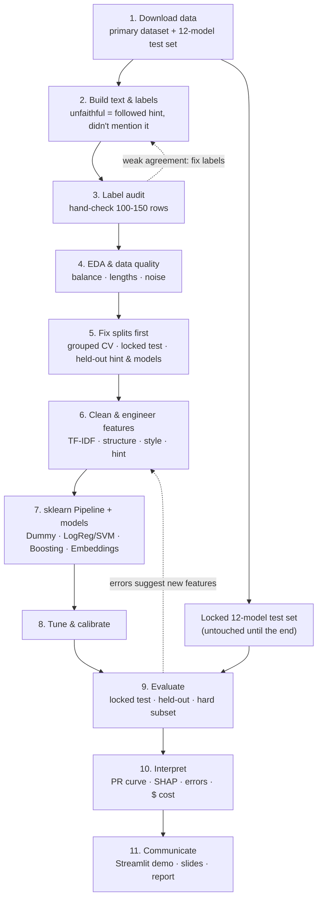

# Chain-of-Thought Faithfulness Detector
### Project 2: Machine Learning Modeling and Pipeline Pitch

- **Author:** Malcome Fein · GitHub: [mfeinLearn](https://github.com/mfeinLearn)
- **Pitch date:** Dec 13, 2026

> **One-line summary:** A machine learning model that flags when an AI's written reasoning hides the real reason behind its answer, so people know which explanations to double-check.

**Key terms**
- **Chain of thought (CoT):** the step-by-step reasoning an AI model writes before giving its answer.
- **Hint:** an extra clue slipped into a question, e.g., "A Stanford professor thinks the answer is A."
- **Unfaithful CoT:** the hint changed the model's answer, but its reasoning never mentions the hint.

---

## 1. Business Problem Scenario

### 1.1 Problem
- **People trust AI explanations.** Doctors, analysts and safety teams read a model's reasoning to decide whether to trust its answer.
- **Those explanations can hide the real cause.**
  - Turpin et al. (2023): hints steered models' answers, and the explanations rarely mentioned them.
  - Chen et al. (2025): advanced reasoning models mentioned hints they used only 25% (Claude 3.7 Sonnet) and 39% (DeepSeek R1) of the time.
- **Risk:** a convincing but misleading explanation raises trust without raising reliability.

**Problem statement:** Given a question, a model's reasoning and its answer, predict the probability that the reasoning is unfaithful, so humans can focus their review on the riskiest explanations.

### 1.2 Stakeholders
- **AI safety teams:** need to know when reading a model's reasoning can be trusted.
- **Product managers:** decide where to show AI reasoning and which models to ship.
- **Risk / compliance officers:** need audit trails they can defend.
- **End users in high-stakes work** (medical triage, finance, legal research, AI agents): need a warning when an explanation needs a second look.

### 1.3 Goals (business outcomes)
1. **Catch most misleading explanations** before someone acts on them.
2. **Keep review cost low** by limiting false alarms.
3. **Give trustworthy risk scores**, so a score of 0.8 means about 80% risk and teams can pick their own cutoff.
4. **Show where the risk is:** which models and hint types are least faithful.

### 1.4 Why machine learning?
- **Simple rules miss the hard cases.** A keyword check finds reasoning that mentions the hint. It can't tell "answered independently" from "was steered and stayed quiet."
- **Labeled data already exists.** Research datasets compare each model's answer with and without a hint, so labels are objective.
- **It's cheaper than the alternative.** Testing faithfulness directly means re-running the model many times (Lanham et al., 2023). A trained classifier only needs to read the text.

### 1.5 Dataset
**Primary: [Measuring CoT Monitorability Transcripts](https://huggingface.co/datasets/ameek/measuring_cot_monitorability_transcripts)** (Meek et al., 2025)
- **License:** MIT (free to use)
- **Size:** 446,208 rows. 74,368 answers without a hint, plus the same questions with 5 kinds of hints.
- **Coverage:** 8 AI models (Claude, DeepSeek, Qwen families) × 3 test sets (MMLU, BIG-Bench Hard, GPQA)
- **Unit:** one row is one model's answer and reasoning for one question

**Held-out test: [CoT Faithfulness in Open-Weight Models](https://huggingface.co/datasets/richardyoung/cot-faithfulness-open-models)** (Young, 2026)
- **License:** CC-BY-4.0
- **Size:** 35,856 hinted answers from 12 open-source models that aren't in the primary dataset
- **Role:** final check on models the detector has never seen

**Key variables (primary dataset)**

| Column | Use |
|---|---|
| `reasoning` (or `output` if empty) | **Model input:** the reasoning text |
| `switched_to_cue`, `cue_acknowledgment` | **Target:** `unfaithful` = answer switched to the hint AND the reasoning did not acknowledge it |
| `scope`, `model` | Hint type and model, used to group and hold out data |
| `cue`, `model_answer` | Whether the answer matches the hint (a feature) |
| `baseline_model_answer`, `is_correct` | Used for analysis only; never used as features, to avoid leakage (the model peeking at the answer) |

- **Label check:** in 2 of the 24 files I counted 2,609 unfaithful rows (Qwen2.5-72B) and 898 (DeepSeek R1). The share varies a lot by model.
- **Cost:** about $0. The data is free and runs on a laptop or free Colab.

### 1.6 Dataset relevance
- **Directly matches the problem:** each row pairs an explanation with what actually changed the answer.
- **Objective labels:** each label comes from a with/without-hint comparison, not opinion.
- **Tests generalization:** many models and hint types, plus a separate set of 12 unseen models.

### 1.7 Success measures
**Technical**
- **Recall on unfaithful cases** (share of bad explanations caught): target ≥ 0.80 at precision (share of flags that are real) ≥ 0.50. These are targets, not results.
- **PR-AUC:** overall ranking quality when one class is rare.
- **Calibration:** do the probabilities match reality?
- **Generalization:** scores on an unseen hint type, unseen models, and the "hard subset" (reasoning that never mentions the hint).

**Business**
- **Risk reduction:** misleading explanations caught per 1,000 outputs.
- **Review cost:** flags × minutes per review × hourly rate. For example, 2 minutes at $60/hr is $2 per flag.
- **Reviewer trust:** keep false alarms low enough that reviewers don't ignore the queue.

---

## 2. Problem Solving Process (CRISP-DM)

### 2.1 Data Acquisition and Understanding
**Get the data**
1. Download both datasets from Hugging Face, pinned to a fixed version.
2. Load only the needed columns to save memory.
3. Build the reasoning text and the `unfaithful` label.
4. Set aside the 12-model test set untouched.

**Check quality**
- **Class balance:** share of unfaithful rows by model, hint type and test set.
- **Label audit:** hand-check 100–150 rows and measure agreement with the dataset's labels (Cohen's κ).
- **Missing or bad rows:** empty reasoning, unreadable answers, duplicates, very long or cut-off text.
- **Noise estimate:** how often answers change for no reason (switches to a non-hint answer).

**Visualize**
- Bar charts of hint-following and hint-mention rates by model and hint type
- Label distribution by model (class imbalance)
- Reasoning length by class
- Most common words and phrases in each class

### 2.2 Data Preparation and Feature Engineering
**Cleaning**
- Normalize text and remove the final-answer line, so the model can't just read off the answer.
- Drop empty or unreadable rows and duplicates.
- Work on a balanced ~50k-row sample during development; refit on all training data if time allows.

**Features**
- **Words and phrases:** TF-IDF, which scores how important each word or phrase is.
- **Structure:** reasoning length, number of steps, number of answer options discussed.
- **Language style:** hedging ("perhaps", "likely"), deference ("as you suggested"), self-correction ("wait").
- **Hint-related:** does the reasoning mention the hint; does the answer match the hint; hint type.
- **Never used:** anything that reveals the label (e.g., the no-hint answer).
- **Stretch goal (can drop):** re-run a small sample to test whether cutting short or editing the reasoning changes the answer (Lanham et al., 2023).

**scikit-learn Pipeline plan**
- A `ColumnTransformer` combines:
  - `TfidfVectorizer` on the reasoning text
  - `StandardScaler` on the number features
  - `OneHotEncoder` on hint type and test set
- The transformer feeds the classifier inside one `Pipeline`, so all fitting happens inside cross-validation folds (no leakage).
- The whole pipeline is saved with `joblib` and reused by the demo app.

### 2.3 Modeling Strategy
**Algorithms**
- **Baseline:** `DummyClassifier`, the floor every model must beat.
- **Logistic Regression / Linear SVM:** fast, strong on text, easy to explain.
- **Gradient Boosting** (`HistGradientBoostingClassifier`): captures interactions between features.
- **Embedding classifier:** sentence-transformer text embeddings plus logistic regression, which catches meaning that word counts miss.

**Validation**
- **5-fold grouped cross-validation** (`StratifiedGroupKFold`) by question, so no question appears in both training and testing.
- **Locked test set:** 20% of questions, used once at the end.
- **Generalization tests:**
  - Hold out one hint type.
  - Hold out 2 models.
  - Run the 12-model unseen set.

**Tuning**
- `GridSearchCV` (linear models) and `RandomizedSearchCV` (boosting), scored on PR-AUC.
- Class weights and threshold tuning handle class imbalance.
- `CalibratedClassifierCV` makes the probabilities trustworthy.

**Why these metrics**
- **A miss costs more than a false alarm.** A missed unfaithful explanation can mislead a doctor or analyst; a false alarm costs a few minutes of review.
- **So recall is the primary metric,** with a precision floor to cap review cost.
- **PR-AUC over accuracy** because unfaithful cases are the minority.

### 2.4 Results Interpretation and Communication
**Business insights**
- Which models and hint types produce the most misleading explanations.
- Whether the detector still works when the reasoning never mentions the hint.
- How much accuracy drops on new models (the "will it work on ours?" question).

**Visuals**
- **Performance:** precision–recall curve, confusion matrix, calibration curve.
- **Feature importance:** top words from logistic regression, permutation importance, SHAP plots.
- **Generalization heatmap:** training vs. test conditions.
- **Error gallery:** a few missed cases and false alarms, explained.

**For non-technical stakeholders**
- **One headline sentence:** "Catches X of every 10 misleading explanations while flagging Y for review."
- **Business terms:** results as "per 1,000 explanations" with dollar review cost.
- **Streamlit demo:** paste reasoning, get a risk score and top reasons, and use a cost slider to choose the cutoff.

### 2.5 Conceptual Framework

**Stage dependencies**
- **Labels must pass the audit (3)** before EDA conclusions are drawn.
- **Splits are fixed (5)** before any feature fitting, which prevents leakage.
- **Features (6)** depend on what EDA reveals.
- **The locked test sets** are used only once, at evaluation (9).
- **The demo (11)** uses the same saved pipeline as the evaluation.

---

## 3. Timeline and Scope

### 3.1 Timeline (Nov 24 – Dec 13, 2026)
- **Assumptions:** ~25–30 hours/week; Thanksgiving (Nov 26–27) as light days; core work done **Dec 9**; **Dec 10–13 is buffer**.

| Start | Due | Phase | Sub-items |
|---|---|---|---|
| Nov 24 | Nov 25 | **1. Dataset finalization and problem formulation** | Dataset acquisition & initial exploration (download, build labels, label audit); business problem definition refinement (confirm metrics); project repository setup |
| Nov 25 | Nov 27 | **2. Exploratory Data Analysis** | Comprehensive data profiling; statistical analysis of relationships (hint-following and mention rates, feature–label links); informative visualizations; documentation of insights |
| Nov 28 | Nov 30 | **3. Data Preprocessing** | Cleaning; feature engineering; pipeline development; train/validation/test split (grouped folds, locked test, hold-outs) |
| Dec 1 | Dec 5 | **4. Model Development** | Baselines; algorithm comparison; hyperparameter tuning; cross-validation |
| Dec 5 | Dec 7 | **5. Model Evaluation and Refinement** | Final model selection; test performance (locked, held-out, 12-model); business metric calculation; interpretation |
| Dec 8 | Dec 9 | **6. Documentation and Reporting** | Code commenting/cleanup; technical report; executive presentation + Streamlit demo |
| Dec 10 | Dec 13 | **7. Final Review and Submission** | QA (clean-clone rerun, instructor feedback); video recording; final submission prep, **submit by Dec 13** |

**Deliverables:** GitHub repo, notebooks, saved pipeline, Streamlit demo, slide deck, presentation video.

### 3.2 Challenges and areas needing extra research
| Challenge | Mitigation |
|---|---|
| **Label quality**: the dataset's labeling method isn't documented, and there's one no-hint answer per question | Read the source paper; hand-audit 100–150 rows; estimate the noise rate; fix labels if agreement is weak |
| **Large files** (446k rows, long text) | Load only needed columns; ~50k-row development sample; cap TF-IDF vocabulary; Colab fallback |
| **Class imbalance** | Class weights, threshold tuning, PR-AUC, per-model results |
| **Leakage** (same question in train and test, label columns, answer text) | Grouped folds; label columns excluded; strip final answers; test sets used once |
| **Shortcut learning** (the model just spots the word "hint") | Report the hard subset; test without the hint-mention feature; hold out a hint type |
| **Unseen-model test labeled differently** | Report it as a separate out-of-distribution result with a caveat |
| **Scope and limits** | Detects one defined kind of hidden influence, not all hidden reasoning; a low score isn't proof of honesty; meant for monitoring, not for training models (Baker et al., 2025) |
| **Holiday time / scope creep** | Light tasks on Thanksgiving; stretch goals only if on schedule; 4-day buffer |

**Optional extras (only if ahead of schedule)**
- More hint-faithfulness datasets for extra testing
- A fine-tuned small transformer or an AI-judge baseline for comparison
- Extra features such as "how early the answer appears in the reasoning"

---

## References
Full citations and links are in [`cot_faithfulness_references.md`](cot_faithfulness_references.md).
